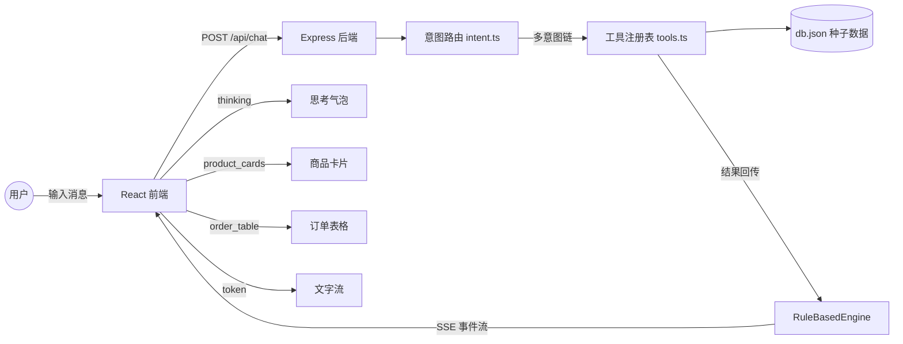

# CartPilot — 电商智能导购 & 客服 Agent

面向电商场景的 AI Agent 应用：用户在聊天窗口里用自然语言提问，Agent 通过**工具调用**查询商品目录、订单状态、生成推荐与对比结果，并以**结构化卡片 / 表格**渲染回前端。

## ✨ 特性

- **工具调用 Agent**：统一 `AgentTool` 接口（`name / description / parameters / execute`），6 个内置工具覆盖搜索、详情、订单、推荐、对比。
- **意图路由**：关键词 + 正则识别多意图，一次对话可串联多个工具（例如"500 以内评分高的蓝牙耳机，顺便看看我上次买的耳机订单"→ `search_products` + `list_orders`）。
- **SSE 流式响应**：`thinking / tool_result / product_cards / order_table / token / done` 六类事件，前端实时渲染。
- **富渲染前端**：商品以卡片呈现（纯色块 + 首字母占位），订单以表格呈现，附带状态徽章与物流轨迹。
- **Provider 预留**：`AgentEngine` 接口 + 默认 `RuleBasedEngine`；`OpenAIEngine` 骨架已就位，接入真实 LLM 只需补全调用闭环。
- **多用户切换**：前端顶部可切换演示账号，订单查询按当前用户隔离。
- **纯手写样式**：浅色清爽电商风，无第三方 UI 库。

## 🏛️ 架构



## 👤 演示账号

| ID | 姓名 | 订单数 |
|----|------|--------|
| `u_001` | 张伟 | 3 |
| `u_002` | 李娜 | 3 |
| `u_003` | 王强 | 3 |

## 🚀 快速开始

```bash
npm install          # 安装 client + server 所有依赖
npm run dev          # 并发启动：server :3002 + client :5174
npm run build        # 仅构建前端
```

- 前端：http://localhost:5174（Vite 代理 `/api` → `:3002`）
- 后端：http://localhost:3002/api/health

## 📁 目录结构

```
cartpilot-agent/
├── package.json              # 根 workspace 配置
├── README.md
├── LICENSE
├── client/                   # React 18 + Vite + TypeScript
│   ├── index.html
│   ├── vite.config.ts        # 端口 5174，代理 /api → :3002
│   └── src/
│       ├── main.tsx
│       ├── App.tsx           # 布局、状态、SSE 事件折叠
│       ├── api.ts            # REST + SSE 流解析
│       ├── types.ts
│       ├── styles.css        # 纯手写浅色电商风
│       └── components/
│           ├── CatalogPanel.tsx   # 左侧可折叠商品目录
│           ├── ChatPanel.tsx      # 聊天主区 + 快捷 chips
│           ├── MessageItem.tsx    # 消息分段渲染
│           ├── ProductCards.tsx   # 商品卡片网格
│           ├── OrderTable.tsx     # 订单表格 + 物流轨迹
│           └── UserSwitcher.tsx   # 顶部用户切换
└── server/                   # Express + TypeScript + tsx
    ├── package.json
    ├── tsconfig.json
    ├── data/db.json          # 运行时由种子数据落盘
    └── src/
        ├── server.ts         # 入口
        ├── data/
        │   ├── seed.ts       # 23 商品 + 9 订单 + 3 用户
        │   └── db.ts         # 加载 / 落盘
        ├── agent/
        │   ├── types.ts      # Product / Order / AgentTool / AgentEngine
        │   ├── tools.ts      # 6 个工具实现
        │   ├── intent.ts     # 关键词 + 正则意图识别
        │   ├── engine.ts     # RuleBasedEngine
        │   └── openai.ts     # OpenAIEngine 骨架
        └── routes/
            ├── api.ts        # REST 商品 / 订单 / 用户
            └── chat.ts       # SSE 对话接口
```

## 🔌 如何接入真实 LLM

1. 设置环境变量：
   ```bash
   AGENT_ENGINE=openai
   OPENAI_API_KEY=sk-...
   OPENAI_BASE_URL=https://api.openai.com/v1   # 可选
   OPENAI_MODEL=gpt-4o-mini                    # 可选
   ```
2. 在 `server/src/agent/openai.ts` 的 `run()` 中补全：
   - 用 `buildToolSchemas()` 生成的 tools 数组调用 Chat Completions（`stream: true`）；
   - 解析 `delta.tool_calls`：先 `emit("thinking", …)`，再执行对应 `AgentTool`，`emit("tool_result", …)`，商品/订单分别 `emit("product_cards")` / `emit("order_table")`；
   - 将工具结果以 `role: "tool"` 消息回填，循环调用直到模型返回纯文本；
   - 正文 delta 逐段 `emit("token")`，结束时 `emit("done")`。
3. 事件协议与 `RuleBasedEngine` 完全一致，前端无需任何改动。

## 🛒 如何扩充商品数据

- 编辑 `server/src/data/seed.ts` 中的 `seedProducts` / `seedOrders`。
- 删除 `server/data/db.json`（或让服务首次启动时覆盖），重启即生效。
- 品类字段为联合类型 `"数码" | "家居" | "服饰" | "美妆" | "食品"`，新增品类需同步修改 `types.ts` 与 `intent.ts` 的 `CATEGORIES` 映射。

## 📄 License

MIT © 2026 CartPilot Contributors
